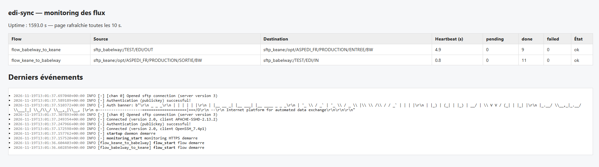

# SRV_EDI_TRANSFERT_SFTP

Daemon Linux, lancé en tant que **service systemd**, qui transfère en **temps réel** des fichiers EDI entre deux serveurs SFTP, de manière **bidirectionnelle** (exemple avec babelway/keane) :

- `flow_babelway_to_keane` : `/TEST/EDI/OUT` (eu1.babelway.net) → `/opt/ASPEDI_FR/PRODUCTION/ENTREE/BW` (keane.cemoi.fr)
- `flow_keane_to_babelway` : `/opt/ASPEDI_FR/PRODUCTION/SORTIE/BW` (keane.cemoi.fr) → `/TEST/EDI/IN` (eu1.babelway.net)

## Architecture

```
┌──────────────────┐  flow_babelway_to_keane   ┌──────────────────┐
│  sftp_babelway   │ ─────────────────────────► │    sftp_keane    │
│  /TEST/EDI/OUT   │  OUT ──► ENTREE/BW        │  .../ENTREE/BW   │
│  /TEST/EDI/IN    │ ◄───────────────────────── │  .../SORTIE/BW   │
└──────────────────┘  flow_keane_to_babelway   └──────────────────┘
        (daemon edi-sync sur le serveur EDI, /opt/EDI/edi-sync)
```

Le daemon tourne sur un serveur Linux intermédiaire et gère **un thread par flux** (connexions SFTP dédiées par flux) :

| Composant | Rôle |
|---|---|
| Scanner (par flux) | Scanne la **racine** du répertoire source distant toutes les N secondes (pas de récursivité dans les sous-dossiers), détecte les fichiers nouveaux et *stables* |
| Queue persistante (SQLite) | Stocke chaque transfert avec son état (`pending`, `done`, `failed`), ses tentatives et ses timestamps ; au démarrage, les `failed` sont remis en `pending` |
| Worker (par flux) | Télécharge vers `staging/`, vérifie la taille source↔local, upload vers `IN/.<nom>.tmp` puis **rename atomique**, archive localement, supprime la source |
| Purge | Supprime les archives locales de plus de `archive_retention_days` jours (toutes les heures) |
| Monitoring | Mini serveur HTTPS (voir ci-dessous) |
| Superviseur | Reconnexion SFTP automatique, keepalive 30 s, backoff exponentiel, arrêt propre sur SIGTERM/SIGINT |
| Service systemd | `edi-sync.service` (system) ou `edi-sync-user.service` (`--user`) : `Restart=always` |

## Règles de transfert

- **Anti-boucle** : seuls les répertoires sources (`source_dir`) sont scannés ; un fichier livré côté destination n'est jamais relu.
- **Scan racine seule** : les sous-dossiers de `source_dir` (ex. `KA/`, `REV/`, `SOL/`, `COPIES/`) **ne sont pas parcourus**.
- **Fichier stable** : taille inchangée entre 2 scans consécutifs ; les suffixes `.tmp`/`.part` et fichiers cachés sont ignorés.
- **Anti-doublon** : clé unique `(flow, nom, taille, mtime)` dans la queue SQLite.
- **Transfert atomique** côté destination : upload en `.<nom>.tmp` puis rename, jamais de fichier partiel visible. Après le rename, si le fichier n'est plus visible au `stat` (la plateforme peut le déplacer immédiatement), c'est un warning, pas une erreur ; erreur seulement si la taille constatée diffère.
- **Après succès** : le fichier est archivé **localement** dans `local_archive_dir/<flow>/` (ex. `/opt/EDI/ARCHIVE/flow_babelway_to_keane/`), puis **supprimé du SFTP source**, état `done`.
- **Purge** : les archives locales sont supprimées automatiquement après N jours (`archive_retention_days`, 7 par défaut).
- **Conflit de nom** côté `IN` : même nom + même taille = déjà livré (ignoré) ; taille différente = upload sous `<nom>.dup-<timestamp>`.
- **Échec** : 5 tentatives avec backoff (30 s → 1 min → 5 min → 15 min → 1 h), puis `failed` + alerte. Au redémarrage du daemon, les `failed` sont automatiquement remis en `pending` (nouvel essai).

## Structure

```
SRV_EDI_TRANSFERT_SFTP/
├── README.md                  # ce fichier
├── requirements.txt           # paramiko
├── src/
│   └── edi_sync.py            # daemon (flows + monitoring HTTPS en threads, queue SQLite, paramiko)
├── config/
│   └── config.ini.example     # exemple de configuration
├── systemd/
│   ├── edi-sync.service       # unité systemd (mode system, root)
│   └── edi-sync-user.service  # unité systemd --user (mode sans root, template __APP_DIR__)
├── install/
│   └── install.sh             # playbook d'installation (modes system / --user [PREFIX])
├── tests/
│   └── test_edi_sync.py       # tests unitaires (logique pure + serveur HTTP de monitoring, loopback)
└── docs/
    ├── architecture.md        # décisions d'architecture détaillées
    └── monitoring-ui.png      # capture de la page de monitoring (données de démo)
```

## Tests

```bash
cd SRV_EDI_TRANSFERT_SFTP
python -m py_compile src/edi_sync.py
python -m unittest discover -s tests -v
python src/edi_sync.py --config config/config.ini.example --check
```

Les tests unitaires couvrent la logique pure (config, queue SQLite, stabilité, backoff, nommage) sans dépendance à paramiko ni à un serveur SFTP. La CI GitHub Actions les rejoue à chaque push/PR sur ce sous-dossier.

## Recette de fonctionnement (en production, sur le serveur EDI)

`tests/recette.py` vérifie le service actif, le monitoring (`/health`, `/api/status`, heartbeats) et fait un **vrai transfert de test** (`TEST_EDI_SYNC_<ts>.edi`) par flow : dépôt source → livraison destination → suppression source → archive locale.

```bash
/opt/EDI/edi-sync/venv/bin/python ~/DEV_EDI/SRV_EDI_TRANSFERT_SFTP/tests/recette.py \
    --config /opt/EDI/edi-sync/config.ini --monitoring-password 'MOTDEPASSE'
# un seul flow :
... --flow flow_keane_to_babelway
```

> Le dépôt du fichier test se fait dans `source_dir`. Si le compte SFTP est en read-only sur ce répertoire (ex. `/TEST/EDI/OUT` sur babelway), lancer la recette sur l'autre flow (ex. `flow_keane_to_babelway`, `SORTIE/BW` est writable) ou demander à la plateforme de déposer un fichier test.

## Configuration

Fichier `/etc/edi-sync/config.ini` sur le serveur cible (voir `config/config.ini.example`) :

```ini
[general]
scan_interval_sec = 5
stability_scans = 2
max_retries = 5
archive_retention_days = 7
state_dir = /var/lib/edi-sync
local_archive_dir = /opt/EDI/ARCHIVE   # archive locale : <local_archive_dir>/<flow>/ ; vide = pas d'archive

[sftp_babelway]
host = sftp-babelway.exemple.com
port = 22
user = edi
key_file = /etc/edi-sync/keys/id_rsa_babelway
host_fingerprint = sha256:xxxxx

[sftp_keane]
host = sftp-keane.exemple.com
port = 22
user = edi
key_file = /etc/edi-sync/keys/id_rsa_keane
host_fingerprint = sha256:yyyyy

[flow_babelway_to_keane]
source = sftp_babelway
source_dir = /out
dest = sftp_keane
dest_dir = /in

[flow_keane_to_babelway]
source = sftp_keane
source_dir = /out
dest = sftp_babelway
dest_dir = /in
```

## Installation (serveur Linux cible)

**Mode system (recommandé, nécessite root)** :

```bash
sudo bash install/install.sh
sudo systemctl enable --now edi-sync
```

Crée l'utilisateur système `edisync`, déploie le code dans `/opt/edi-sync/`, la config dans `/etc/edi-sync/` (600, owner edisync) + `keys/` (700), l'état dans `/var/lib/edi-sync/` et l'unité systemd système.

**Mode user (sans aucun droit root)** — le daemon tourne sous ton compte. Préfixe par défaut `~/edi-sync`, personnalisable (ex. `/opt/EDI/edi-sync`) :

```bash
git clone https://github.com/rcanovasCemoi/DEV_EDI.git ~/DEV_EDI
bash ~/DEV_EDI/SRV_EDI_TRANSFERT_SFTP/install/install.sh --user /opt/EDI/edi-sync
# éditer /opt/EDI/edi-sync/config.ini : key_file pointent directement vers ~/.ssh/id_rsa_* (pas de copie)
/opt/EDI/edi-sync/venv/bin/python /opt/EDI/edi-sync/edi_sync.py --config /opt/EDI/edi-sync/config.ini --check
systemctl --user enable --now edi-sync
systemctl --user status edi-sync
journalctl --user -u edi-sync -f    # ou: tail -f /opt/EDI/edi-sync/log/daemon.log si log_file renseigné
```

> Pour que le service user démarre aussi sans session ouverte, demander à l'admin root une seule fois : `loginctl enable-linger $USER` (sinon le service démarre à ta première connexion).

## Supervision

```bash
systemctl status edi-sync
journalctl -u edi-sync -f
```

- Heartbeat par flow : `<state_dir>/heartbeat_flow_babelway_to_keane`, `heartbeat_flow_keane_to_babelway` (nommés d'après les sections `[flow_*]`)
- Métriques `pending/done/failed` par flow dans la base SQLite (`<state_dir>/queue.db`)
- Logs JSON sur stdout (journald) ; option `[general] log_file = /chemin/daemon.log` pour aussi écrire dans un fichier (utile en mode user sans accès au journal). Les erreurs incluent un champ `traceback`
- Alerte si heartbeat absent ou si des transferts sont en `failed`

## Monitoring (mini serveur HTTPS embarqué)

Le daemon embarque un serveur HTTPS dans un thread dédié (même process, état partagé avec la queue) :

- **Accès** : bind `127.0.0.1:8443` par défaut — ne jamais binder `0.0.0.0`. Accès distant via tunnel SSH : `ssh -L 8443:127.0.0.1:8443 utilisateur@serveur-edi`, puis ouvrir `https://localhost:8443/`
- `GET /` : page HTML de suivi des flux (état `ok`/`stale`/`error`, heartbeat, compteurs `pending/done/failed`, 30 derniers événements avec leur champ `error`, auto-refresh 10 s)
- `GET /api/status` : mêmes données en JSON (événements avec `error`)
- `GET /health` : sonde `200 ok`
- Certificat **auto-signé** généré au premier démarrage dans `/var/lib/edi-sync/certs/` (ou cert/key fournis via `tls_cert` / `tls_key` dans `[monitoring]`)
- **Basic Auth optionnelle** : `auth_user` + `auth_password_sha256` (sha256 du mot de passe, ex. `echo -n 'motdepasse' | sha256sum`)

Exemple de section `[monitoring]` (voir `config/config.ini.example`) :

```ini
[monitoring]
enabled = true
bind = 127.0.0.1
port = 8443
auth_user = admin
auth_password_sha256 = <sha256 du mot de passe>
```

Aperçu de la page (données de démo servies par le serveur HTTPS réel en local) :



## Sécurité

- Clés SSH dédiées par sens de transfert (`chmod 600`), **pas de mot de passe**
- Empreintes du serveur SFTP épinglées (`host_fingerprint` : une ou plusieurs `sha256:...` séparées par des virgules — récupérées via `ssh-keyscan -t rsa,ecdsa,ed25519 <host> | ssh-keygen -lf -`), vérification à chaque connexion
- Config et clés lisibles uniquement par l'utilisateur de service `edisync` (et `root`) : `/etc/edi-sync/config.ini` en 600 owner `edisync`, `/etc/edi-sync/keys/` en 700 owner `edisync`, clés en 600
- Service systemd sandboxé : `NoNewPrivileges`, `ProtectSystem=strict`, `PrivateTmp`, `ReadWritePaths` limités
