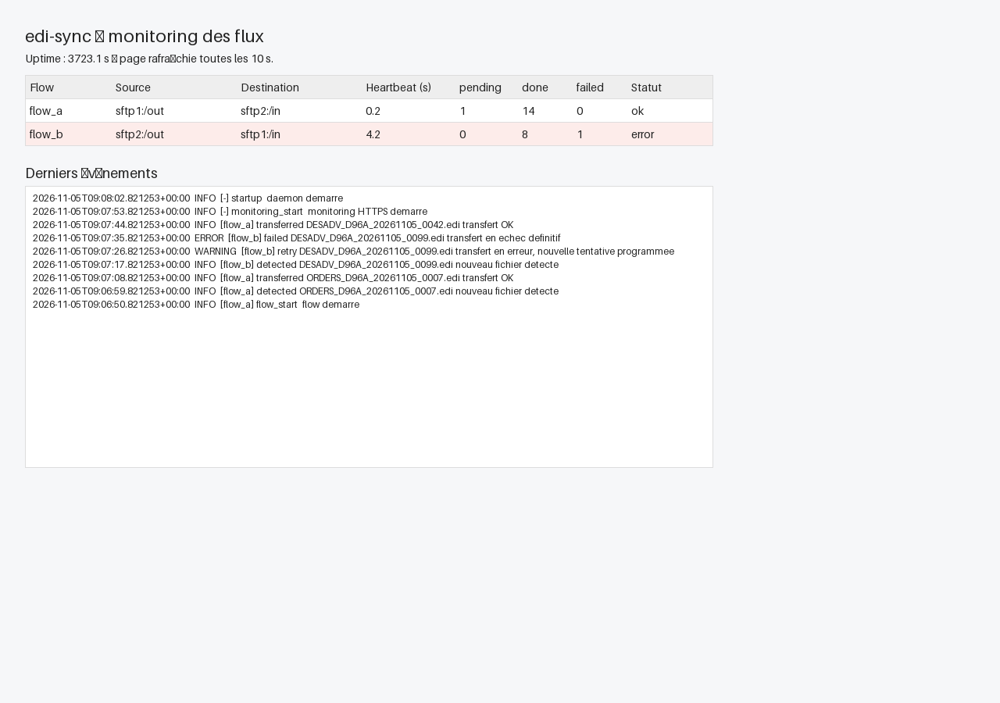

# SRV_EDI_TRANSFERT_SFTP

Daemon Linux, lancé en tant que **service systemd**, qui transfère en **temps réel** des fichiers EDI d'un serveur SFTP à un autre, de manière **bidirectionnelle** :

- `OUT` du SFTP 1 → `IN` du SFTP 2
- `OUT` du SFTP 2 → `IN` du SFTP 1

## Architecture

```
┌─────────┐     flow A : OUT → IN      ┌─────────┐
│ SFTP 1  │ ─────────────────────────► │ SFTP 2  │
│  /out   │   sftp1/out ──► sftp2/in   │  /in    │
│  /in    │ ◄───────────────────────── │  /out   │
│ /archive│     flow B : OUT → IN      │ /archive│
└─────────┘   sftp2/out ──► sftp1/in   └─────────┘
            (daemon edi-sync au milieu)
```

Le daemon tourne sur un serveur Linux intermédiaire et gère **deux flux indépendants**, chacun dans son propre thread :

| Composant | Rôle |
|---|---|
| Scanner (par flux) | Scanne le répertoire `OUT` distant toutes les N secondes, détecte les fichiers nouveaux et *stables* |
| Queue persistante (SQLite) | Stocke chaque transfert avec son état (`pending`, `downloading`, `uploading`, `done`, `failed`), ses tentatives et ses timestamps |
| Worker (par flux) | Télécharge vers un répertoire local `staging/`, vérifie la taille, upload vers `IN/.<nom>.tmp` puis **rename atomique** |
| Superviseur | Reconnexion SFTP automatique, backoff exponentiel, reprise des transferts interrompus au démarrage |
| Service systemd | `edi-sync.service` : `Restart=always`, utilisateur dédié, sandboxing |

## Règles de transfert

- **Anti-boucle** : seuls les répertoires `OUT` sont scannés ; un fichier livré dans `IN` n'est jamais relu.
- **Fichier stable** : taille inchangée entre 2 scans consécutifs ; les suffixes `.tmp`/`.part` et fichiers cachés sont ignorés.
- **Anti-doublon** : clé unique `(flow, nom, taille, mtime)` dans la queue SQLite.
- **Transfert atomique** côté destination : upload en `.<nom>.tmp` puis rename, jamais de fichier partiel visible.
- **Après succès** : le fichier source est déplacé de `OUT` vers `archive/<flow>/` (pas de suppression immédiate), état `done`.
- **Purge** : les archives sont supprimées automatiquement après N jours (7 par défaut).
- **Conflit de nom** côté `IN` : même nom + même taille = déjà livré (ignoré) ; taille différente = upload sous `<nom>.dup-<timestamp>`.
- **Échec** : 5 tentatives avec backoff (30 s → 1 min → 5 min → 15 min → 1 h), puis `failed` + alerte.

## Structure

```
SRV_EDI_TRANSFERT_SFTP/
├── README.md                  # ce fichier
├── requirements.txt           # paramiko
├── src/
│   └── edi_sync.py            # daemon (flows + monitoring HTTPS en threads, queue SQLite, paramiko)
├── config/
│   └── config.ini.example     # exemple de configuration
├── systemd/
│   └── edi-sync.service       # unité systemd
├── install/
│   └── install.sh             # playbook d'installation sur le serveur cible
├── tests/
│   └── test_edi_sync.py       # tests unitaires (logique pure + serveur HTTP de monitoring, loopback)
└── docs/
    └── architecture.md        # décisions d'architecture détaillées
```

## Tests

```bash
cd SRV_EDI_TRANSFERT_SFTP
python -m py_compile src/edi_sync.py
python -m unittest discover -s tests -v
python src/edi_sync.py --config config/config.ini.example --check
```

Les tests unitaires couvrent la logique pure (config, queue SQLite, stabilité, backoff, nommage) sans dépendance à paramiko ni à un serveur SFTP. La CI GitHub Actions les rejoue à chaque push/PR sur ce sous-dossier.

## Configuration

Fichier `/etc/edi-sync/config.ini` sur le serveur cible (voir `config/config.ini.example`) :

```ini
[general]
scan_interval_sec = 5
stability_scans = 2
max_retries = 5
archive_retention_days = 7
state_dir = /var/lib/edi-sync

[sftp1]
host = sftp1.exemple.com
port = 22
user = edi
key_file = /etc/edi-sync/keys/id_ed25519_sftp1
host_fingerprint = sha256:xxxxx

[sftp2]
host = sftp2.exemple.com
port = 22
user = edi
key_file = /etc/edi-sync/keys/id_ed25519_sftp2
host_fingerprint = sha256:yyyyy

[flow_a]                       # sftp1 -> sftp2
source = sftp1
source_dir = /out
dest = sftp2
dest_dir = /in
archive_dir = /archive/flow_a

[flow_b]                       # sftp2 -> sftp1
source = sftp2
source_dir = /out
dest = sftp1
dest_dir = /in
archive_dir = /archive/flow_b
```

## Installation (serveur Linux cible)

```bash
sudo bash install/install.sh
sudo systemctl enable --now edi-sync
```

L'installation crée l'utilisateur système `edisync`, déploie le code dans `/opt/edi-sync/`, la config dans `/etc/edi-sync/` (chmod 600), l'état dans `/var/lib/edi-sync/` et l'unité systemd.

## Supervision

```bash
systemctl status edi-sync
journalctl -u edi-sync -f
```

- Heartbeat par flow : `/var/lib/edi-sync/heartbeat_flow_a`, `heartbeat_flow_b`
- Métriques `pending/done/failed` par flow dans la base SQLite
- Alerte si heartbeat absent ou si des transferts sont en `failed`

## Monitoring (mini serveur HTTPS embarqué)

Le daemon embarque un serveur HTTPS dans un thread dédié (même process, état partagé avec la queue) :

- **Accès** : bind `127.0.0.1:8443` par défaut — ne jamais binder `0.0.0.0`. Accès distant via tunnel SSH : `ssh -L 8443:127.0.0.1:8443 utilisateur@serveur-edi`, puis ouvrir `https://localhost:8443/`
- `GET /` : page HTML de suivi des flux (état `ok`/`stale`/`error`, heartbeat, compteurs `pending/done/failed`, 30 derniers événements, auto-refresh 10 s)
- `GET /api/status` : mêmes données en JSON
- `GET /health` : sonde `200 ok`
- Certificat **auto-signé** généré au premier démarrage dans `/var/lib/edi-sync/certs/` (ou cert/key fournis via `tls_cert` / `tls_key` dans `[monitoring]`)
- **Basic Auth optionnelle** : `auth_user` + `auth_password_sha256` (sha256 du mot de passe, ex. `echo -n 'motdepasse' | sha256sum`)

Exemple de section `[monitoring]` (voir `config/config.ini.example`) :

```ini
[monitoring]
enabled = true
bind = 127.0.0.1
port = 8443
auth_user = admin
auth_password_sha256 = <sha256 du mot de passe>
```

Aperçu de la page (données de démo servies par le serveur HTTPS réel en local) :



## Sécurité

- Clés SSH dédiées par sens de transfert (`chmod 600`), **pas de mot de passe**
- Empreinte du serveur SFTP épinglée (`host_fingerprint`), `StrictHostKeyChecking` effectif
- Config et clés lisibles uniquement par `root` (`/etc/edi-sync/`, chmod 600)
- Service systemd sandboxé : `NoNewPrivileges`, `ProtectSystem=strict`, `PrivateTmp`, `ReadWritePaths` limités
